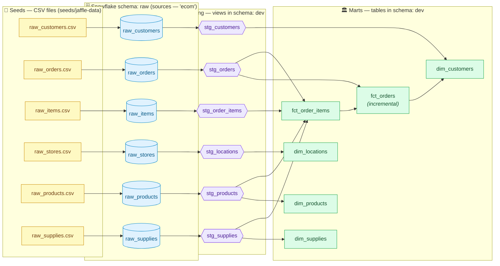

# Jaffle Shop — Data Lineage & Flow

> How data flows through this dbt project, from raw CSV seeds to the final
> analytics marts. This describes a **cold start**: nothing exists in Snowflake yet.
>
> Target warehouse (from `profiles.yml` → `jaffle_shop_dbt_project`):
> **database** `DBTPROJECTDB`, **dev schema** `dev`, **seed schema** `raw`.

---

## 1. Lineage graph (the DAG)



---

## 2. The layers explained

| Layer | What it is | Materialization | Snowflake location |
|-------|-----------|-----------------|--------------------|
| **Seeds** | 6 CSV files shipped in the repo (`seeds/jaffle-data/`). Gated behind `var('load_source_data')`. | `seed` → tables | `DBTPROJECTDB.raw.*` |
| **Sources** | Logical pointers (`ecom`) to the raw tables the seeds create. Defined in `models/staging/__sources.yml`. | — (not built) | `DBTPROJECTDB.raw.*` |
| **Staging** | 1:1 cleanup/renaming of each source. Light transforms only. | `view` | `DBTPROJECTDB.dev.stg_*` |
| **Marts** | Business-level fact (`fct_`) and dimension (`dim_`) tables, analytics-ready. | `table` (except `fct_orders` = `incremental`) | `DBTPROJECTDB.dev.*` |

### Dependency edges (exact, from the SQL)

- `stg_customers`  ← source `ecom.raw_customers`
- `stg_orders`     ← source `ecom.raw_orders`
- `stg_order_items`← source `ecom.raw_items`
- `stg_locations`  ← source `ecom.raw_stores`
- `stg_products`   ← source `ecom.raw_products`
- `stg_supplies`   ← source `ecom.raw_supplies`
- `fct_order_items`← `stg_order_items`, `stg_orders`, `stg_products`, `stg_supplies`
- `fct_orders`     ← `stg_orders`, `fct_order_items`
- `dim_customers`  ← `stg_customers`, `fct_orders`
- `dim_locations`  ← `stg_locations`
- `dim_products`   ← `stg_products`
- `dim_supplies`   ← `stg_supplies`

> **Build order dbt computes from this DAG:** seeds → all 6 staging views →
> `fct_order_items` → `fct_orders` → `dim_customers` (+ `dim_locations`,
> `dim_products`, `dim_supplies` run as soon as their inputs exist).

### About the one incremental model

`fct_orders` is materialized **incremental** (`unique_key='order_id'`, `merge` strategy).
- **First run** (table doesn't exist yet): dbt builds it from scratch — the full history.
- **Later runs**: `is_incremental()` is true, so dbt only processes orders newer than the
  max `ordered_at` already loaded, then `merge`s them in on `order_id`.
- Force a rebuild any time with `dbt build --select fct_orders --full-refresh`.

---

## 3. Step-by-step: a cold start (nothing in Snowflake yet)

Assumes real Snowflake credentials are in place for the `jaffle_shop_dbt_project`
profile.

1. **Install package dependencies**
   ```bash
   dbt deps
   ```
   Fetches `dbt_utils` into `dbt_packages/`. *(Already done in this workspace.)*

2. **Sanity-check the connection** (creates nothing)
   ```bash
   dbt debug          # verifies Snowflake login + DBTPROJECTDB access
   dbt parse          # validates the project graph
   ```

3. **Load the raw data from the CSV seeds** — this populates an empty warehouse:
   ```bash
   dbt seed --full-refresh --vars '{"load_source_data": true}'
   ```
   - Creates schema `DBTPROJECTDB.raw` and loads the 6 CSVs into `raw.raw_*`.
   - Without `load_source_data: true` the seeds stay **disabled** and the sources
     would have nothing to read.

4. **Build the models and run all tests**
   ```bash
   dbt build
   ```
   Runs each node in DAG order and tests it before dependents run: 6 `stg_*` views,
   then `fct_order_items` → `fct_orders` → `dim_customers`, plus the three other
   dimensions — alongside the generic tests, the singular test, and the unit test.

5. **(Optional) Explore**
   ```bash
   dbt docs generate && dbt docs serve   # browsable lineage + catalog
   dbt show --select fct_orders          # preview rows
   ```

### What exists in Snowflake after step 4

```
DBTPROJECTDB
├── raw   (from dbt seed)
│   ├── raw_customers        (table)
│   ├── raw_orders           (table)
│   ├── raw_items            (table)
│   ├── raw_stores           (table)
│   ├── raw_products         (table)
│   └── raw_supplies         (table)
└── dev   (from dbt build)
    ├── stg_customers        (view)
    ├── stg_orders           (view)
    ├── stg_order_items      (view)
    ├── stg_locations        (view)
    ├── stg_products         (view)
    ├── stg_supplies         (view)
    ├── fct_order_items      (table)
    ├── fct_orders           (table, incremental)
    ├── dim_customers        (table)
    ├── dim_locations        (table)
    ├── dim_products         (table)
    └── dim_supplies         (table)
```

> Schema routing comes from `macros/generate_schema_name.sql`: seeds are forced
> into a literal `raw` schema, while every other model lands in the target schema
> (`dev`). With the `prod` target, custom schemas would be prefixed (e.g. `prod_…`).
