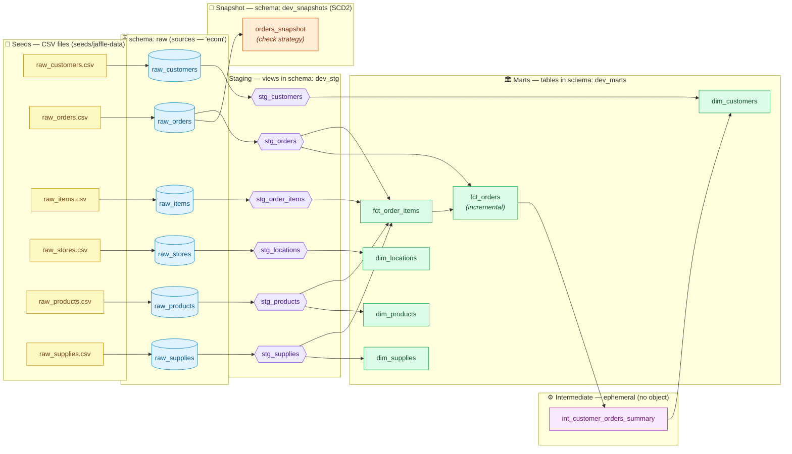

# Jaffle Shop — Data Lineage & Flow

> How data flows through this dbt project, from raw CSV seeds to the final
> analytics marts. This describes a **cold start**: nothing exists in Snowflake yet.
>
> Target warehouse (from `profiles.yml` → `jaffle_shop_dbt_project`, `dev` target):
> **database** `JAFFLE_SHOP_DB`. Schemas: `raw` (seeds), `dev_stg` (staging),
> `dev_marts` (marts), `dev_snapshots` (snapshot). The intermediate layer is
> **ephemeral**, so it creates no schema/object.

---

## 1. Lineage graph (the DAG)

---

## 2. The layers explained

| Layer | What it is | Materialization | Snowflake location |
|-------|-----------|-----------------|--------------------|
| **Seeds** | 6 CSV files shipped in the repo (`seeds/jaffle-data/`). Gated behind `var('load_source_data')`. | `seed` → tables | `JAFFLE_SHOP_DB.raw.*` |
| **Sources** | Logical pointers (`ecom`) to the raw tables the seeds create. Defined in `models/staging/_sources.yml`. | — (not built) | `JAFFLE_SHOP_DB.raw.*` |
| **Staging** | 1:1 cleanup/renaming of each source. | `view` | `JAFFLE_SHOP_DB.dev_stg.stg_*` |
| **Intermediate** | Re-grains orders to one row per customer before the customers dimension. | `ephemeral` (inlined as a CTE) | **none** — no object created |
| **Marts** | Fact (`fct_`) and dimension (`dim_`) tables, analytics-ready. | `table` (except `fct_orders` = `incremental`) | `JAFFLE_SHOP_DB.dev_marts.*` |
| **Snapshot** | SCD Type 2 history of `raw_orders` (check strategy). | `snapshot` | `JAFFLE_SHOP_DB.dev_snapshots.orders_snapshot` |

### Dependency edges (exact, from the SQL)

- `stg_*` ← their matching `ecom.raw_*` source
- `fct_order_items` ← `stg_order_items`, `stg_orders`, `stg_products`, `stg_supplies`
- `fct_orders` (incremental) ← `stg_orders`, `fct_order_items`
- `int_customer_orders_summary` (ephemeral) ← `fct_orders`
- `dim_customers` ← `stg_customers`, `int_customer_orders_summary`
- `dim_locations` ← `stg_locations` · `dim_products` ← `stg_products` · `dim_supplies` ← `stg_supplies`
- `orders_snapshot` ← source `ecom.raw_orders`

### Incremental vs snapshot — the side-by-side
Both are built from the **same orders source**, so they contrast cleanly:
- **`fct_orders`** (incremental, `merge` on `order_id`) keeps only the **current** state of each order.
- **`orders_snapshot`** (SCD2, `check` strategy on `id`) keeps the **full history**: when a tracked column changes, the old row is closed with `dbt_valid_to` and a new current row is added.

---

## 3. Step-by-step: a cold start

1. `dbt deps` — install `dbt_utils`. *(Already done.)*
2. `dbt debug` / `dbt parse` — verify connection and validate the graph (create nothing).
3. `dbt seed --full-refresh --vars '{"load_source_data": true}'` — load the 6 CSVs into `raw.*`.
4. `dbt build --vars '{"load_source_data": true}'` — builds seeds, staging views, marts, the snapshot, and runs every test (generic, singular, unit) in DAG order. The ephemeral intermediate is inlined, not built.
5. *(Optional)* `dbt docs generate && dbt docs serve` for the lineage site; `dbt snapshot` to re-capture history after a data change.

> **Schema routing** comes from `macros/generate_schema_name.sql`: seeds go to a bare
> `raw` schema; every other model is prefixed with the target schema
> (`dev` + `stg` → `dev_stg`, `dev` + `marts` → `dev_marts`; under the `prod` target,
> `prod_stg`, `prod_marts`, …). Models with no `+schema` stay in the target schema.
